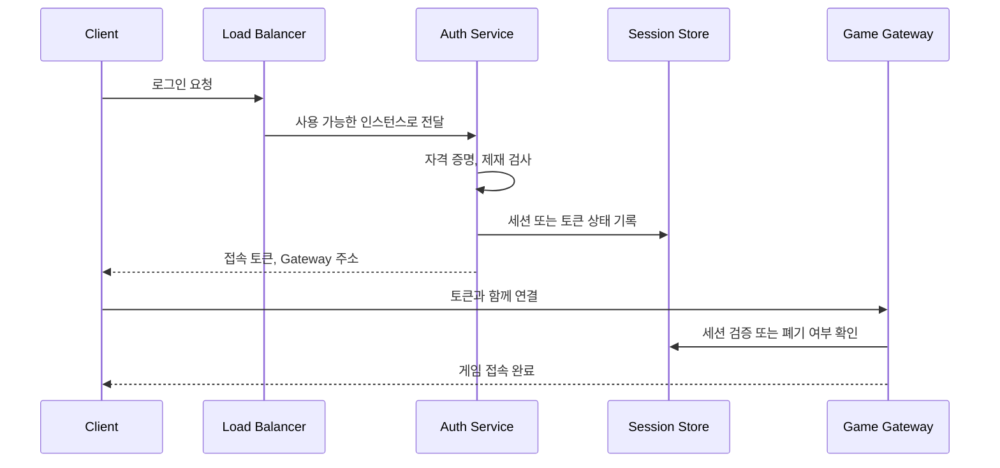
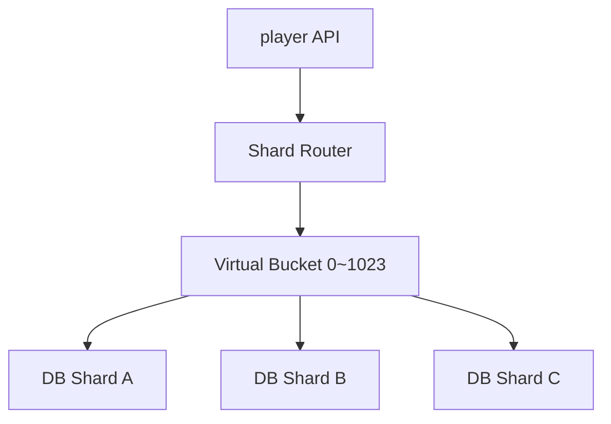
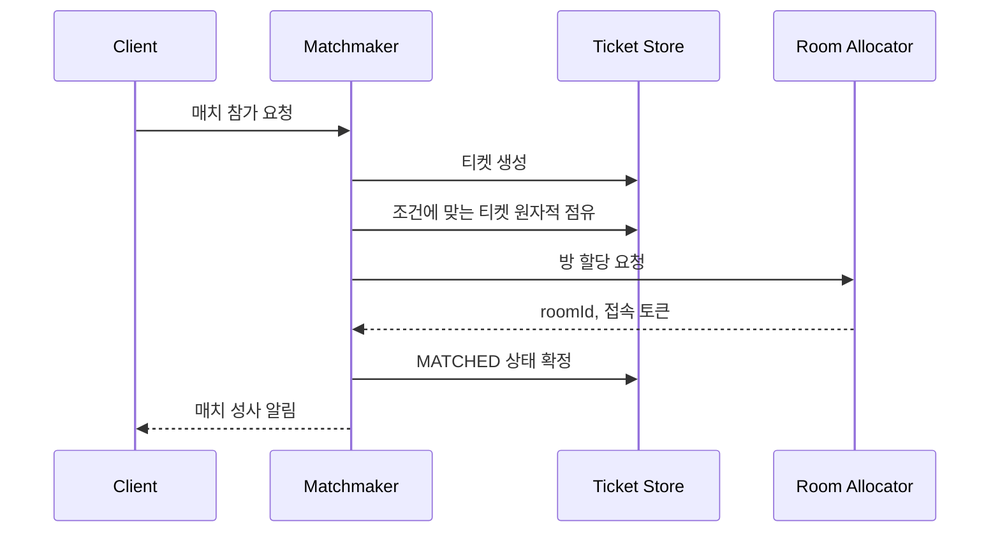
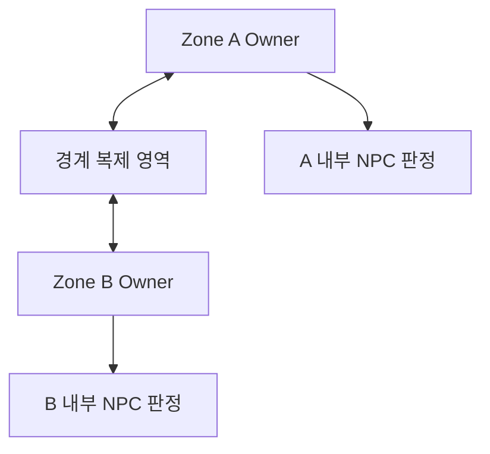
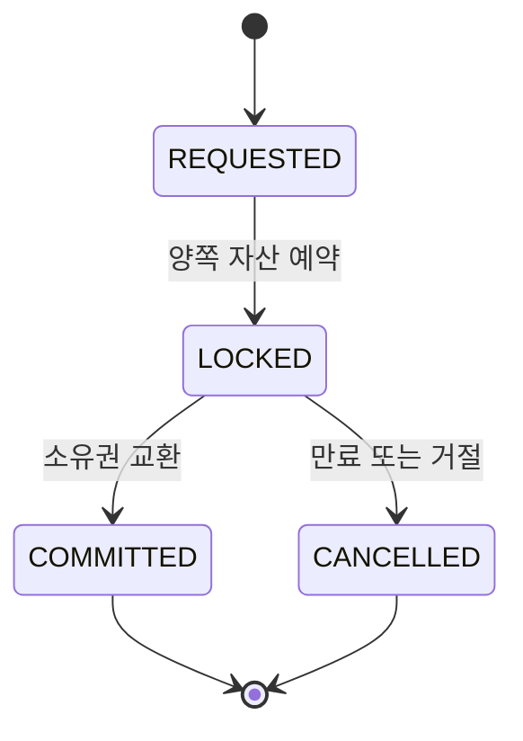
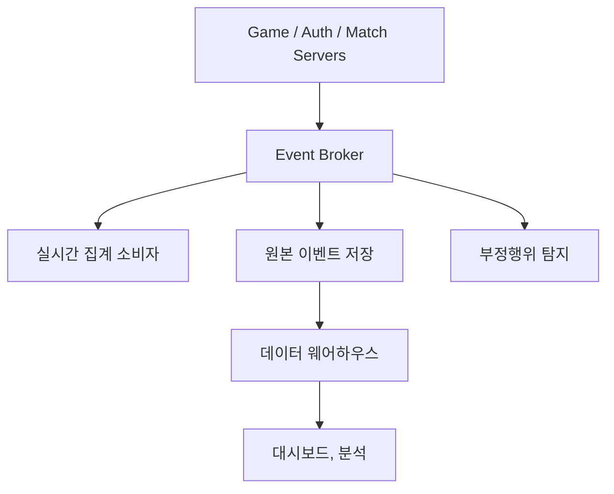
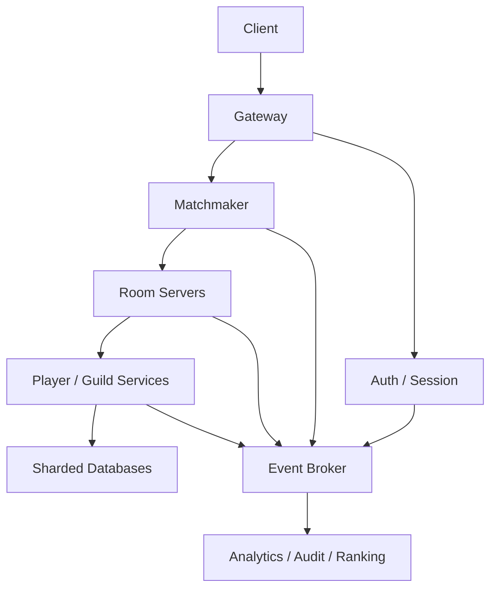

# 분산 서버 구조 사례

---

## 분석 틀

| 질문                            | 답변                                    |
| ------------------------------- | --------------------------------------- |
| 분산 키는?                      | playerId, matchId, zoneId, guildId      |
| 상태의 권위자는?                | PlayerService, RoomServer, GuildService |
| 강한 일관성이 필요한 범위       | 재화 차감, 아이템 소유권, 매치 참가자   |
| 지연을 허용할 수 있는 데이터는  | 통계, 추천, 전역 랭킹 모델              |
| 서버 장애 때 무엇을 복구하는가? | 세션, 방 체크포인트, 대기열 티켓        |
| 부하를 어떤 지표로 나누는가?    | 연결 수, 틱 CPU, 큐 길이, DB 처리량     |

---

## 로그인 처리의 분산

로그인 서버는 사용자의 자격 증명을 확인, 제재 및 점검 상태를 검사, 접속할 Gateway나 게임 서버들을 배정한다. 출시 직후나 점검 종료 직후에 짧은 시간에 요청이 몰리므로 상태 없는 인증 인스턴스를 수평 확장하는 구조가 유리하다



### 로그인 서버를 상태 없게 만들기

인증 인스턴스의 메모리에 세션을 저장하면 다음 요청이 다른 인스턴스로 갔을 때 세션을 찾을 수 없다. 대안은 두 가지다.

- 서명된 짧은 수명의 토큰을 발급, Gateway가 서명을 검증
- 세션 ID만 발급하고 공유 세션 저장소에서 상태를 조회

| 방식      | 장점                           | 주의                                    |
| --------- | ------------------------------ | --------------------------------------- |
| 서명 토큰 | 매 요청의 세션 DB 조회를 줄임  | 즉시 강제 로그아웃과 권한 변경이 어려움 |
| 서버 세션 | 폐기와 동시 접속 제어가 쉬움   | 세션 저장소가 핵심 의존성이 된다        |
| 혼합 방식 | 짧은 토큰 + 폐기 버전으로 절충 | 설계와 운영 규칙이 더 필요하다          |

게임에서 짧은 수명의 접속 토큰과 서버 측 sessionVersion 또는 접속 상태를 함께 쓰는 방식이 실용적이다.

```ts
type LoginResult = {
  accessToken: string;
  gatewayUrl: string;
  expiresAt: string;
};

@Injectable()
export class AuthService {
  constructor(
    private readonly accounts: AccountRepository,
    private readonly sanctions: SanctionRepository,
    private readonly sessions: SessionStore,
    private readonly tokenIssuer: TokenIssuer,
    private readonly gatewayDirectory: GatewayDirectory,
  ) {}

  async login(command: LoginCommand): Promise<LoginResult> {
    const account = await this.accounts.verifyCredential(
      command.accountName,
      command.password,
    );

    if (await this.sanctions.isBlocked(account.id)) {
      throw new ForbiddenException("account is blocked");
    }

    const session = await this.sessions.createOrReplace({
      accountId: account.id,
      deviceId: command.deviceId,
      requestId: command.requestId,
    });

    const gateway = await this.gatewayDirectory.pick({
      region: command.region,
    });

    return this.tokenIssuer.issue({
      accountId: account.id,
      sessionId: session.id,
      sessionVersion: session.version,
      audience: gateway.id,
      expiresInSeconds: 120,
      gatewayUrl: gateway.url,
    });
  }
}
```

비밀번호 검증은 CPU를 많이 사용하는 해시 연산이다. 이벤트 루프에서 동기 해시 API를 사용하면 다른 로그인 요청까지 멈춘다. 비동기 API를 쓰고 동시 검증 수를 제한, 필요하면 전용 인증 작업자로 격리한다

### 로그인 폭주 제어

- 계정, IP, 디바이스별 속도 제한을 둔다
- 서버가 감당할 수 없으면 대기열과 예상 대기 시간을 제공한다
- 모든 클라이언트가 같은 간격으로 재시도하지 않도록 지수 백오프와 지터를 안내한다
- 외부 인증 제공자의 장애가 내부 스레드, 연결 풀을 모두 점유하지 않게 타임아웃과 회로 차단을 둔다
- 계정 존재 여부를 노출하지 않도록 오류 메시지와 응답 시간을 설계한다

### 중복 로그인 정책

동시 접속을 허용할지, 기존 세션을 끊을지, 디바이스별로 허용할지를 제품 정책으로 먼저 정한다. createOrReplace 같은 연산은 원자적으로 수행하고 sessionVersion을 증가시켜 오래된 토큰을 무효화한다

## 데이터베이스 수평 확장

플레이어 수와 저장량이 한 데이터베이스의 한계를 넘으면 데이터를 여러 샤드로 나눈다. 게임에서 playerId가 자연스러운 분산 키인 경우가 많다



### 단순 나머지 방식 문제

hash(playerId) % shardCount는 간단하나 샤드 수가 4개에서 5개로 바뀌면 대부분의 플레이어 위치가 달라진다. 대규모 이동을 피하려면 고정된 가상 버킷을 두는 방법이 좋다

1. playerId를 0~1023 같은 고정 버킷으로 매핑한다
2. 버킷과 실제 샤드의 매핑을 별도 설정에 둔다
3. 증설할 때 일부 버킷만 새 샤드로 옮긴다
4. 이동 중에 버킷 상태와 세대 번호로 읽기, 쓰기를 제어한다

```ts
type BucketPlacement = {
  bucket: number;
  shardId: string;
  generation: number;
  state: "ACTIVE" | "MOVING";
  nextShardId?: string;
};

export class PlayerShardRouter {
  private static readonly BUCKET_COUNT = 1024;

  constructor(
    private readonly placements: PlacementCache,
    private readonly repositories: Map<string, PlayerRepository>,
  ) {}

  async route(playerId: string): Promise<{
    repository: PlayerRepository;
    generation: number;
  }> {
    const bucket = stableHash(playerId) % PlayerShardRouter.BUCKET_COUNT;
    const placement = await this.placements.get(bucket);
    const repository = this.repositories.get(placement.shardId);
    if (!repository) {
      throw new Error("unknown shard");
    }
    return { repository, generation: placement.generation };
  }
}
```

### 샤드 이동 절차

데이터 이동은 단순 복사로 끝나지 않는다. 복사 중에도 쓰기가 발생하기 때문이다

1. 이동할 버킷을 MOVING 상태로 표시
2. 원본 스냅샷을 대상 샤드로 복사한다
3. 복사 중 발생한 변경 로그를 대상에 적용한다
4. 짧은 전환 구간에 쓰기를 정지하거나 이중 쓰기를 검증
5. generation을 올리고 라우팅을 새 샤드로 바꾼다
6. 검증과 보존 기간이 끝난 뒤 원본 데이터를 정리한다

이중 쓰기는 한쪽만 성공하는 문제가 있어 변경 로그, outbox, 재시도, 검증 작업이 필요하다. migrationId와 generation으로 오래된 라우터의 쓰기를 거부해야 한다

### 샤드 간 기능

친구 검색, 전체랭킹, 운영자 검색처럼 온라인 요청에서 매번 모든 샤드를 조회하지 않는 편이 좋다

- 이벤트로 별도 전역 읽기 모델을 만든다
- 검색 엔진이나 분석 저장소에 필요한 필드를 복제
- 배치 집계 결과를 캐시에 게시
- 운영자 도구에 시간 제한과 결과 수 제한을 둔다

### 전역 ID

각 샤드의 자동 증가 숫자만 쓰면 전역에서 충돌할 수 있다. UUID, ULID, Snowflake 계열 ID처럼 분산 생성 가능한 ID를 쓰거나, ID 발급 서비스를 둔다. ID에 샤드 위치를 영구히 인코딩하면 향후 이동이 어려워질 수 있어 라우팅 정보와 식별자를 분리하는 편이 안전하다

## 매치메이킹의 분산 처리

매치메이킹은 대기 중인 플레이어를 지역, 게임 모드, 파티 크기, 실력, 대기 시간 등의 조건으로 묶고 게임 방을 배정한다

### 기본 흐름



### 대기열 분산 키

매치메이커 전체를 하나의 큐로 두면 한 인스턴스가 병목이 된다. 자연스러운 분할 키는 다음과 같다

- region
- gameMode
- inputType
- partySize
- ranked 또는 normal

너무 잘게 나누면 후보가 적어 매치 품질과 속도가 떨어진다. 분산 키와 검색 범위를 다르게 가져갈 수 있다. region, mode로 파티션을 나누고, rating 범위는 대기 시간에 따라 넓힌다.

```ts
type MatchTicket = {
  ticketId: string;
  partyId: string;
  region: string[];
  gameMode: string;
  rating: number;
  createdAt: Date;
  status: "WAITING" | "CLAIMED" | "MATCHED" | "CANCELLED";
  claimOwner?: string;
  claimExpiresAt?: Date;
};
```

### 중복 매치 방지

매치메이커가 같은 티켓을 동시에 선택하면 한 플레이어가 두 게임에 배정될 수 있다. 티켓 점유는 조건부 원자 연산으로 수행한다

```ts
async claimTicket(
  ticketId: string,
  workerId: string,
  now: Date,
): Promise<MatchTicket | null> {
  const claimExpiresAt = new Date(now.getTime() + 5_000);

  return this.tickets.findOneAndUpdate(
    {
      ticketId,
      status: "WAITING",
    },
    {
      $set: {
        status: "CLAIMED",
        claimOwner: workerId,
        claimExpiresAt,
      },
    },
    { returnDocument: "after" },
  );
}
```

claim에 만료시간이 필요하다. 작업자가 죽으면 다른 작업자가 티켓을 다시 가져갈 수 있어야 한다. 다만 오래된 작업자가 뒤늦게 결과를 확정하지 못하도록 claimVersion 또는 fencing token을 함께 확인한다

### 취소와 매치 성사의 경쟁

클라이언트 취소 요청과 매치 확정이 동시에 일어날 수 있다. 상태 전이를 명시하고 조건부 갱신을 사용한다

```ts
const transitions = {
  WAITING: ["CLAIMED", "CANCELLED"],
  CLAIMED: ["WAITING", "MATCHED", "CANCELLED"],
  MATCHED: [],
  CANCELLED: [],
} as const;
```

매치가 이미 확정된 뒤 취소가 도착하면 단순히 티켓을 지우지 말고 게임 규칙에 따라 노쇼, 재접속, 대체 참가자 정책을 적용한다.

### 파티와 실력 범위

- 파티는 개별 플레이어가 아니라 원자적인 티켓으로 취급한다
- 대기 시간이 길어질수록 허용 rating 범위를 단계적으로 넓힌다
- 매치 품질 점수와 예상 대기 시간을 함께 측정한다
- 봇을 투입하면 사람 매치와 구분해 분석할 수 있어야 한다
- 클라이언트가 보낸 rating이나 지역을 그대로 신뢰하지 않는다

### 방 할당 실패

티켓을 골랐으나 RoomServer 할당이 실패할 수 있다. 제한 시간 안에 방을 얻지 못하면 claim을 풀어 WAITING으로 되돌리거나, 같은 matchRequestId로 안전하게 재시도한다. 방 할당 서비스 역시 같은 요청에 같은 roomId를 반환하도록 멱등해야 한다

## 몬스터 NPC 처리 분산 처리

NPC 처리는 이동, 시야, 경로 탐색, 스킬 판단, 전투 판정 때문에 CPU를 많이 사용할 수 있다. 분산 단위는 NPC 한 마리보다 **상호 작용이 많은 공간이나 방**이 적합하다.

### 방 단위 분산

인스턴스 던전, MOBA, FPS는 matchId 또는 roomId를 한 RoomServer에 배정한다

- 한 틱의 판정을 프로세스 메모리에서 처리할 수 있음
- 방 사이 통신이 거의 없다
- 방 종료 시 상태를 정리하기 쉽다
- 특정 방이 과부하되면 다른 방과 격리할 수 있음

### 존 단위 분산

MMORPG의 연속된 월드는 zoneId나 공간 셀로 나눌 수 있다



경계 근처 객체는 이웃 존에 읽기 전용 유령 객체로 복제할 수 있다. 실제 위치와 전투 판정의 쓰기 권위자는 한 존만 가져야 한다

### NPC 소유권

```ts
type NpcAuthority = {
  npcId: string;
  zoneId: string;
  ownerServerId: string;
  generation: number;
};
```

소유권이 이동할 때 다음 상태를 함께 옮긴다

- 위치, 속도, HP, 상태 이상
- AI 상태 머신과 목표
- 스킬 재사용 대기시간
- 난수 생성기의 결정적 상태가 필요한 경우 seed와 순서
- 처리되지 않은 중요 이벤트

이전 소유자는 generation이 바뀐 뒤 더 이상 판정 결과를 저장할 수 없어야 한다

### AI 처리량 줄이기

모든 NPC를 매 틱 동일한 품질로 계산할 필요는 없다

- 플레이어와 가까운 NPC는 높은 빈도로 처리한다
- 먼 NPC는 낮은 빈도나 단순 상태 머신으로 처리한다
- 경로 탐색은 작업 큐나 Worker Thread에 보내되 결과 적용 시 월드 버전을 확인
- 경로와 시야 결과를 짧게 캐시
- 한 틱에 처리할 AI 작업 예산을 두고 다음 틱으로 넘긴다

```ts
type PathRequest = {
  requestId: string;
  npcId: string;
  worldVersion: number;
  start: Vec3;
  goal: Vec3;
};

type PathResult = {
  requestId: string;
  npcId: string;
  worldVersion: number;
  points: Vec3[];
};

function applyPath(result: PathResult, world: WorldState): void {
  if (result.worldVersion !== world.version) {
    return;
  }
  world.npcs.get(result.npcId)?.setPath(result.points);
}
```

비동기 계산 결과가 도착했을 때 월드가 이미 바뀌었을 수 있어 버전 검사가 필요

### 핫 존

보스 등장이나 대규모 전투로 한 존에 사용자가 몰리면 단순 존 분할만으로 해결되지 않을 수 있다

- 공간 셀을 더 잘게 나누고 관심 영역을 제한한다
- 관전자와 비전투 사용자의 업데이트 빈도를 낮춘다
- NPC AI와 비핵심 계산을 별도 작업자로 보낸다
- 수용 인원 제한이나 채널 복제를 적용한다
- 대규모 전투 전용 인스턴스로 이동시킨다

한 전투의 강하게 결합된 판정을 여러 서버에 무리하게 쪼개면 네트워크 동기화 비용이 CPU 절감보다 클 수 있다

## 플레이어 간 상호 작용 분산 처리

같은 방의 이동과 전투처럼 빈번한 상호 작용은 한 RoomServer에 처리하는 것이 자연스럽다. 친구, 길드, 우편, 거래처럼 방 밖의 상호 작용은 별도 소유 서비스가 필요하다

### 같은 방 상호 작용

- RoomServer가 위치와 전투 판정의 권위자이다.
- 클라이언트는 의도를 보내고 서버가 결과를 판정한다
- 방 안 이벤트는 하나의 틱 순서로 처리한다
- 영구 보상은 결과 명령으로 PlayerService에 전달

### 길드와 채팅

길드 데이터는 guildId로 분산하고 GuildService가 멤버, 권한, 공동 자원의 권위를 가진다. 채팅 서버는 멤버십 읽기 모델을 복제할 수 있으나, 강퇴나 채팅 금지처럼 보안에 민감한 결정은 버전과 만료 시간을 확인해야 한다

### 플레이어 거래

거래는 두 플레이어의 아이템과 재화를 동시에 바꾸므로 분산 환경에 가장 어려운 기능 중 하나이다.

가능한 전략:

1. 두 플레이어 데이터를 같은 거래 서비스와 같은 데이터베이스 트랜잭션 경계에 둔다
2. 아이템을 에스크로에 잠근 뒤 단계별 상태를 영속화한다
3. Saga로 각 단계를 실행하고 실패하면 보상 동작을 수행한다

단순히 두 PlayerService에 차례로 RPC를 보내면 첫 번째만 성공하고 두 번째가 실패할 수 있다



```ts
type Trade = {
  tradeId: string;
  leftPlayerId: string;
  rightPlayerId: string;
  state: "REQUESTED" | "LOCKED" | "COMMITTED" | "CANCELLED";
  version: number;
  expiresAt: Date;
};
```

### 에스크로 방식

- 거래에 올린 아이템을 원래 인벤토리에 사용 불가 상태로 예약한다
- 양쪽 예약이 완료된 뒤 소유권을 교환한다
- 거래가 만료되거나 실패하면 예약을 해제한다
- 각 단계는 tradeId, version으로 멱등 처리한다
- 운영자가 상태를 조회하고 재개 또는 보정할 도구를 둔다

분산 잠금 하나로 전체 문제를 해결하려 하지 않는 편이 좋다. 잠금 보유자의 일시 정지, 네트워크 단절, 만료 후 뒤늦은 쓰기를 고려하여 영속 상태 머신과 fencing token을 명확히 두는 것이 좋다

### 플레이어 간 선물과 우편

즉시 양쪽 데이터를 함께 바꾸기보다 다음 흐름으로 결합도를 낮춘다

1. 송신자의 재화를 차감하고 우편 항목을 영속화한다
2. 수신자는 자기 PlayerService에 우편을 수령한다
3. 수령 명령은 mailId로 한 번만 처리
4. 만료와 반송 정책을 상태로 기록

구조는 즉시 거래와 의미가 다르므로 게임 디자인에서 허용될 때 사용한다

### 상호 작용 권위

| 기능          | 권위               | 자연스러운 키    | 일관성                        |
| ------------- | ------------------ | ---------------- | ----------------------------- |
| 전투 판정     | RoomServer         | roomId           | 즉시, 강함                    |
| 개인 인벤토리 | PlayerService      | playerId         | 강함                          |
| 길드 멤버십   | GuildService       | guildId          | 변경은 강함, 읽기는 지연 가능 |
| 귓속말 전달   | ChatService        | conversationId   | 중복 허용 후 dedupe 가능      |
| 거래          | TradeService/DB    | tradeId          | 강함, 감사 이력 필요          |
| 우편 수령     | Mail/PlayerService | mailId, playerId | 멱등 처리                     |

## 로그 및 통계 분석의 분산 처리

게임 로그와 분석 이벤트는 양이 크나 대부분 전투 응답 경로에 즉시 처리할 필요가 없다. 게임 서버는 이벤트를 빠르게 기록, 집계와 분석은 별도 파이프라인에 처리한다



### 이벤트 스키마

```ts
type GameEvent<TPayload> = {
  eventId: string;
  eventType: string;
  schemaVersion: number;
  occurredAt: string;
  receivedAt?: string;
  playerId?: string;
  matchId?: string;
  serverId: string;
  traceId?: string;
  payload: TPayload;
};
```

- eventId: 중복 제거에 사용
- occurredAt: 사건이 발생한 시간
- receivedAt: 수집기가 받은 시간으로 지연 측정에 사용
- schemaVersion: 소비자가 여러 버전 이벤트를 해석
- traceId: 온라인 요청과 후속 이벤트를 연결

### 로그와 분석 이벤트 구분

| 종류        | 목적                 | 보존과 구조                               |
| ----------- | -------------------- | ----------------------------------------- |
| 운영 로그   | 오류 조사와 디버깅   | 텍스트 또는 구조화 로그, 비교적 짧은 보존 |
| 감사 로그   | 재화, 권한 변경 추적 | 변조 방지, 긴 보존, 접근 통제             |
| 분석 이벤트 | 행동과 지표 분석     | 안정적인 스키마, 대량 저장                |
| 메트릭      | 상태와 경보          | 집계 수치, 시계열 저장                    |
| 분산 추적   | 요청 경로 분석       | 샘플링된 span, trace                      |

console.log 한 종류로 남기면 비용, 검색 등이 나빠진다

### 게임 경로와 분리

로그 전송이 느리고 게임 틱이 멈춰서는 안 된다. 메모리 버퍼나 로컬 에이전트로 넘기고 비동기로 일괄 전송한다. 다만 프로세스가 죽으면 버퍼가 유실될 수 있으므로 이벤트 중요도에 따라 경로를 나눈다

- 디버그 이벤트: 유실 허용, 샘플링 가능
- 일반 분석 이벤트: 브로커에 비동기 전송, 재시도
- 결제, 재화 감사 이벤트: 비즈니스 트랜잭션과 outbox에 기록

### 배압과 과부하

소비자가 생산 속도를 따라가지 못하면 큐가 쌓인다

- 큐 지연 시간과 파티션별 backlog를 관찰한다
- 소비자를 수평 확장하되 같은 키의 순서 요구를 확인한다
- 이벤트 크기와 배치 크기에 상한을 둔다
- 디버그 이벤트는 샘플링하거나 우선순위를 낮춘다
- 반복 실패 이벤트는 DLQ로 이동하고 원인을 고친 뒤 재처리한다
- 보존 기간을 넘기기 전에 저장 용량과 처리량을 확장한다

### 순서와 중복

전체 이벤트에 전역 순서를 보장하기는 비싸다. 필요한 범위만 playerId 또는 matchId 파티션 안에서 순서를 유지, 소비자는 eventId로 중복을 제거한다. 늦게 도착한 이벤트를 위해 event time 기반 집계와 허용 지연 시간을 둔다

### 개인정보와 보안

- 비밀번호, 액세스 토큰, 세션 쿠키를 로그에 남기지 않는다
- 이메일, IP, 디바이스 식별자는 목적과 보존 기간을 정하고 마스킹한다
- 운영 로그와 분석 저장소의 접근 권한을 분리한다
- 삭제 요청이 원본, 파생 데이터, 백업에 어떻게 반영되는지 문서화한다
- 분석 이벤트는 위조될 수 있어 보상 판정의 근거로 단독 사용하지 않는다

## 게임 장르별 분산 서버 형태

장르에 따라 실시간성, 한 세션의 인원, 상호 작용 범위, 상태 크기가 다르다. 같은 구조를 모든 게임에 적용하면 안 된다

| 장르           | 분산 단위                 | 주요 서버                     | 주의점                             |
| -------------- | ------------------------- | ----------------------------- | ---------------------------------- |
| 턴제, 카드     | matchId, playerId         | API, Match, Player            | 명령 순서, 재접속, 턴 타임아웃     |
| 방 기반 RPG    | roomId, playerId          | Gateway, Room, Player         | 방 결과의 멱등 저장                |
| FPS, 배틀로얄  | matchId                   | Relay/Gateway, Dedicated Room | 틱 지연, 지역 배치, 대역폭         |
| MOBA           | matchId                   | Matchmaker, Room, Ranking     | 한 경기 권위자, 경기 결과 검증     |
| RTS            | matchId                   | Lockstep/Authoritative Room   | 결정성, 입력 순서, 느린 클라이언트 |
| MMORPG         | zoneId, playerId, guildId | Gateway, Zone, Player, Guild  | 존 경계, 핫스폿, 거래 일관성       |
| 방치형, 수집형 | playerId                  | API, Player, Job, Ranking     | DB 처리량, 시간 검증, 배치 작업    |

### 턴제, 카드 게임

프레임 단위의 낮은 지연보다 명령 순서와 재접속 복구가 중요하다. matchId 단위의 상태 머신을 영속화하거나 이벤트 로그를 남기면 서버 이동과 복구가 쉽다

### FPS, 배틀로얄

한 경기의 판정을 전용 RoomServer 하나가 소유, 플레이어와 가까운 지역에 배치한다. 방 하나의 CPU와 대역폭이 배치 기준이다. 서버 장애 시 경기를 복구할 지 무효 처리할 지 비용과 게임 규칙에 따라 정한다

### RTS

결정적 lockstep을 쓰면 입력만 교환해 대역폭을 줄일 수 있으나 모든 참여자의 시뮬레이션이 같아야 한다. 부동소수점, 난수, 실행 순서가 달라지면 상태가 어긋난다. 권위 서버 방식이면 상태 스냅샷과 보정 비율이 늘어난다

### MMORPG

연속 월드, 길드, 거래, 채팅이 얽혀 복잡하다. 공간 상호 작용은 zoneId, 개인 데이터는 playerId, 길드 상태는 guildId로 각각 권위자를 두고, 경계 간 기능은 명시적 프로토콜로 연결한다. 인기 도시와 필드 보스 같은 핫스폿을 별도로 설계해야 한다.

### 방치형, 수집형 게임

실시간 RoomServer보다 API, 데이터베이스가 중요하다. 서버는 클라이언트가 제출한 경과 시간을 신뢰하지 않고 서버 시간을 기준으로 보상을 계산한다. 대규모 일일 초기화는 한 시각에 모든 플레이어 문서를 갱신하지 말고, 마지막 계산 시점에 지연 계산하는 방법을 우선 검토한다

### 상호 작용 그래프로 판단

같은 장르라도 게임 규칙에 따라 구조가 달라진다. 최종 판단에 다음 질문이 더 중요하다

- 동시에 서로 영향을 주는 플레이어 수는 몇 명인지
- 판정 결과가 필요한 최대 시간은 얼마인지
- 상태를 복구해야 하는 단위와 빈도는 무엇인지
- 한 기능이 실패했을 때 어떤 기능까지 멈춰도 되는 지

---

## 사례별 정리

| 사례               | 분산                     | 문제                                  |
| ------------------ | ------------------------ | ------------------------------------- |
| 로그인             | 상태 없는 Auth 인스턴스  | 세션 공유, 폭주 제어, 토큰 폐기       |
| 데이터베이스       | playerId와 가상 버킷     | 재배치, 전역 조회, 샤드 간 작업       |
| 매치메이킹         | region, mode 큐 파티션   | 원자적 claim, 취소 경쟁, 방 할당 실패 |
| NPC                | roomId, zoneId 소유권    | 틱 예산, 경계 복제, 소유권 이동       |
| 플레이어 상호 작용 | 기능별 단일 권위자       | 거래 원자성, 멱등성, 복구 도구        |
| 로그, 통계         | 비동기 이벤트 파이프라인 | 배압, 중복, 스키마, 개인정보          |

## 설계 원칙

1. 먼저 단순하게 만들고 측정된 병목을 기준으로 나눈다
2. 함께 상호 작용하는 상태는 같은 소유자에 둔다
3. 데이터마다 쓰기 권위자를 하나로 정한다
4. 네트워크 호출은 실패하고 메시지는 중복될 수 있다고 가정한다.
5. requestId와 eventId로 명령과 이벤트를 멱등하게 만든다
6. 온라인 판정 경로에 로그, 분석, 느린 저장 작업을 분리한다
7. 장애 복구와 데이터 이동은 정상 운영 기능으로 설계한다
8. 운영자가 상태를 관찰하고 재처리, 보정할 도구를 함께 만든다

## 기준 아키텍처 예시



턴제 소규모 게임이면 여러 상자를 하나의 모듈식 앱으로 합치는 편이 더 좋을 수 있고, MMORPG면 Zone, Chat, Trade, Guild를 더 세분화할 수 있다.

## 복습

### 1. 로그인 서버를 상태 없이 구성하면 어떤 점에서 수평 확장이 쉬워지는지

특정 로그인 서버의 메모리에 사용자 상태를 보관하지 않으면, 어떤 서버가 요청을 받아도 동일하게 처리할 수 있기에 서버 추가, 제거와 장애 대응이 쉬워진다

로그인 서버 A의 메모리에 세션 정보가 있으면, 사용자의 다음 요청도 A로 보내거나 세션을 다른 서버로 옮겨야 한다

로그인 인스턴스가 필요한 정보를 공용 DB, Redis에 조회하거나 검증 가능한 토큰을 사용하면 특정 서버에 요청을 고정할 필요가 줄어든다

- 로드밸런서가 여러 서버에 요청을 분배할 수 있음
- 새로운 서버를 추가해도 기존 사용자 상태를 복사할 필요가 줄어듬
- 서버 장애 시 다른 인스턴스가 요청을 처리할 수 있음
- 배포와 서버 축소 과정에 인스턴스를 교체하기 쉬움

### 2. 서명 토큰과 서버 세션은 각각 어떤 장단점이 있는지

서명 토큰은 서버가 토큰 자체를 검증할 수 있어 세션 조회 의존성을 줄일 수 있으나 즉시 폐기와 최신 권한 반영이 어렵다.

서버 세션은 로그인 상태를 중앙에서 변경, 폐기하기 쉬우나 세션 저장소의 성능과 가용성을 관리해야 한다

### 3. Hash(playerId) % shardCount 방식이 증설에 불리한 이유는

서버 수가 바뀌면 나머지 계산 결과가 달라져 많은 플레이어의 담당 샤드가 변경되기 때문

### 4. 가상 버킷이 데이터 재배치 범위를 어떻게 줄이는지

플레이어를 고정된 논리 버킷에 배치, 버킷과 물리 샤드의 연결만 변경하면 선택한 버킷의 데이터만 이동할 수 있음

### 5. 이벤트 소비자가 eventId로 중복을 제거해야 하는 이유는

이벤트는 재전송과 장애 복구 과정에 중복 도착할 수 있어, 같은 이벤트의 업무 효과가 여러 번 발생하지 않게 해야 한다.

## 참고 자료

- [NestJS Microservices 공식 문서](https://docs.nestjs.com/microservices/basics)
- [NestJS WebSockets 공식 문서](https://docs.nestjs.com/websockets/gateways)
- [Node.js Worker Threads](https://nodejs.org/api/worker_threads.html)
- [MongoDB Sharding](https://www.mongodb.com/docs/manual/sharding/)
- [Kubernetes Horizontal Pod Autoscaling](https://kubernetes.io/docs/tasks/run-application/horizontal-pod-autoscale/)
- [OpenTelemetry JavaScript](https://opentelemetry.io/docs/languages/js/)
